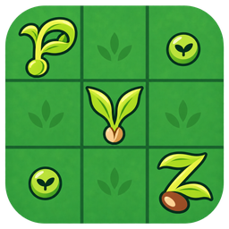

# PVZ Formation Editor



[简体中文](README.md) | [English](README.en.md)

**Plants as pieces. Formation as an art.** A **Windows-first**, cross-platform local formation editor built with **Flutter widgets and Canvas**, combining board editing, local archives, formation codes, image export and Windows live-game integration.

**v1.0.1** · [Website](https://xmpvz.pages.dev/en/) · [User guide](https://xmpvz.pages.dev/en/docs/) · [Windows x64 ZIP](https://xmpvz.pages.dev/downloads/PvZ-Formation-Editor-1.0.1-windows-x64.zip) · [Releases](https://github.com/jadepeakpoet/pvz-formation-editor/releases) · [QQ group 425175276](https://qm.qq.com/q/BbkV57ELaa)

Author and maintainer: **越小梦 (yuexiaomeng)**. Source license: [GNU GPL v3.0](LICENSE).

## Features

- Edit 26 maps with plants, zombies and objects; select sprite appearances, adjust layers, flip, batch-place/remove, add supporting bases, undo and redo.
- Choose encyclopedia and Imitater cards, use ten seed slots, and browse 363 complete presets plus partial layouts with search and map/cannon filters.
- Work with an independent main board and shared sidebar containing Archive Library, Layout Presets, Plant Encyclopedia, Mirrors, Load / Export and Settings. Create up to three read-only mirror snapshots.
- Autosave editable work to local archives, with names, notes, tags, search, select-all, bulk import/export and deletion, deduplication and version history.
- Restore all previously open tabs, the selected tab and file associations when restarting.
- Exchange PvZ Toolkit codes, reference-site codes, complete project JSON and archive collections; save back to source files with overwrite backups and recovery.
- Export PNGs and backgrounds, preserve the game's aspect ratio by default, and preview/copy/save generated images in a popup inside the toolbox. The default export folder is Documents/PvzFormationEditor.
- On Windows, read and apply real game formations, including six standard scenes, Imitaters, mushroom sleep, cannon loading and other stable plant states. Browse and back up game-save files.
- Load and share plant frames on demand. The package includes 363 thumbnails at 256×192, totaling about 7.49 MiB, with a bounded decoded-image cache and local caching for custom previews.
- Use Simplified Chinese or English in the app and on the website.

## Platforms and validation

| Platform | Implementation | Validation / distribution |
| --- | --- | --- |
| **Windows** | Primary platform; independent main/sidebar windows and native PvZ integration | **Release build, startup, windows, autosave, import/export and real 1051 game read/write verified; Windows x64 ZIP distribution** |
| macOS | Flutter desktop project with native dual-window integration | Historical macOS build, startup and desktop-interaction validation; current binary distribution focuses on Windows |
| Linux | Flutter Linux project and file adapters | Source project; platform build/device validation pending |
| Android | Flutter Android project | Source project; device validation pending |
| iOS | Flutter iOS project | Source project; build/device validation pending |

The formation model, editing, rendering, storage and codecs are shared. **Live PvZ process detection, game formation read/write and original game-save directory integration are Windows-specific.**

## Windows quick start

1. Download and fully extract the [v1.0.1 ZIP](https://xmpvz.pages.dev/downloads/PvZ-Formation-Editor-1.0.1-windows-x64.zip).
2. Keep the DLL files and `data` folder beside `pvz_formation_editor.exe`, then run it. The package targets Windows 10 / 11 x64 and includes the local MSVC runtime.
3. Pick a map and plants, or open a preset from Archive Library, then edit.
4. Check autosave status and share codes, project files, archive collections or PNGs.

[Release notes](docs/releases/1.0.1.md) · [Checksums](https://xmpvz.pages.dev/downloads/SHA256SUMS.txt)

## Autosave and local data

Editable formations use My Archives. Opening a preset into an editor tab saves it as editable work. A new blank page becomes an archive on its first effective edit, rename or explicit save. Later changes update the same archive and retain previous versions; Save As creates a separate copy.

Switching tabs and quitting normally flush pending saves. Restarting restores the previous workspace. Undo/redo belongs to each currently open editing session.

The database is `formations.sqlite` in the user application-support directory. Export `*.pvzlib.json` to move current archives between devices. For complete database backups, quit normally and retain any journal/WAL/SHM companions. Application files and user data are stored separately.

## Windows live-game features

The supported target is **original Windows PvZ 1.0.0.1051, Survival Endless modes 11–15**.

- Read from game fills the input above Load / Export. Reading and copying each have independent Toolkit/website format choices. Load into editor opens the code for editing; Paste and import validates clipboard text before loading it.
- Apply formation replaces the current in-game layout. The main toolbar, Load / Export, archive details and each item's More menu expose the same action.
- Website-format reads include zombies. Game integration supports 21 zombie types and their stable appearances, including carried objects, grounded balloons, submerged/surfaced snorkel zombies and eating. Dolphin layouts account for atlas/game position differences and initialize the selected pose while paused; plant highlights initialize the game's chew flash.
- Card defaults select awake appearances for Fume-shrooms, Gloom-shrooms and Magnet-shrooms. Later user choices remain authoritative. Loaded cannons are immediately ready; empty cannons have zero cooldown and begin charging when play resumes.
- Read/write stable growth, height and damage states for supported plants, and browse/import/back up supported game-save files.

Game writes are verified by reading back the formation and related states. See the [Windows integration guide](docs/game-integration/windows-1051.md).

Game writes support six standard scenes. Custom six-row lawns and roofs remain available for editing and produce a clear scene-support message when applied.

## Formats

| Format | Purpose |
| --- | --- |
| PvZ Toolkit code | Standard-scene positions, Imitaters and mushroom sleep |
| Reference-site code | Compatible object positions, sprite frames and effect fields |
| `*.pvzf.json` / `PVZF1:` | Complete editable projects, including cards and display settings |
| `*.pvzlib.json` | Current archive documents, names, notes and tags, with import deduplication |
| PNG | Formation and background images |

Choose complete projects to retain all editor fields. Collections carry current documents; archive history stays in the local database. Imports validate complete input before writing, with limits of 8 MiB and 5,000 objects.

## Development

Project name: `pvz_formation_editor`. Flutter widgets provide the UI, Canvas renders formations, and SQLite stores local archives. Baseline: Flutter **3.47.8 stable**, Dart **3.13.7**, dependencies in `pubspec.lock`.

```sh
flutter pub get
flutter run -d windows
flutter build windows --release
```

Windows builds use Visual Studio 2022 C++ desktop tools. Build other platform projects on their corresponding hosts. See [development](docs/development.md), [macOS](docs/macos-run.md) and [website deployment](website/README.md).

## Credits and license

Primary reference: [jspvz ArrayDesign](http://jspvz.com/ArrayDesign/) by **LonelyStar (囧丫乙)**, extended with local editing, desktop interaction, autosave and game integration.

Technical references: [PvZ Toolkit](https://pvz.tools/toolkit/) by lmintlcx and [PvZ-Portable](https://github.com/wszqkzqk/PvZ-Portable) by wszqkzqk. Thanks to PopCap Games and the Flutter / Dart community.

Source code: [GNU GPL v3.0](LICENSE), Copyright (C) 2026 越小梦 (yuexiaomeng). Assets and third-party dependencies retain their own rights and licenses; see [Acknowledgments](ACKNOWLEDGMENTS.md) and [asset provenance](docs/assets.md).

Apply formation offers an unchecked-by-default Clear zombies option. Lazy Layout also provides a standalone clear action that retains existing plants and sunlight. Formations containing zombies still replace them with the target layout. Archive details use mutually exclusive Toolkit/website choices and one Copy formation code button.
